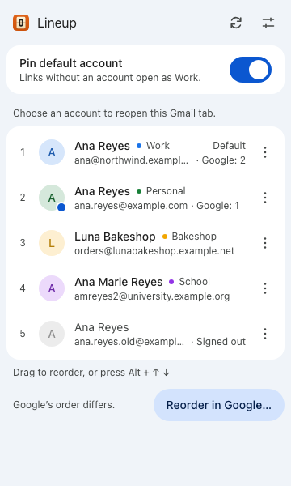
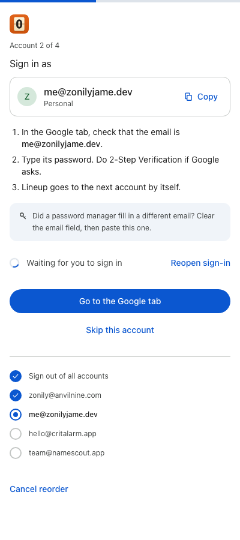

<p align="center">
  
</p>

<h1 align="center">Uzero</h1>

<p align="center">
  <b>Put your Google accounts in <i>your</i> order.</b><br>
  Pick which account is #1. Open Google links in the right account. Reorder Google's own <code>/u/0</code>, <code>/u/1</code>… for real.
</p>

<p align="center">
  
  
  
  
  
</p>

<p align="center">
  <a href="#features">Features</a> •
  <a href="#how-it-works">How it works</a> •
  <a href="#install">Install</a> •
  <a href="#privacy">Privacy</a> •
  <a href="#faq">FAQ</a> •
  <a href="#develop">Develop</a>
</p>

<p align="center">
  <picture>
    <source media="(prefers-color-scheme: dark)" srcset="docs/screenshots/popup-dark.png">
    
  </picture>
  &nbsp;&nbsp;
  
</p>

---

## The problem

Google numbers your accounts by the order you signed in. Your work account is `/u/0` today and your personal one tomorrow. Links from Slack, email and bookmarks open in whichever account is first. To fix the order, you must sign out of everything and sign back in, in the right order, by hand.

**Uzero fixes that.**

## Features

- **Your order.** Drag accounts into the order you want. Give each one a label and a color.
- **Pin your #1.** Google links from outside Google (chat apps, bookmarks, the address bar) open in your #1 account. Or pick an account per service, for example Calendar in your work account.
- **Switch this tab.** Move the current Gmail, Drive, Docs or Calendar tab to another account in one click, or with <kbd>Alt</kbd>+<kbd>1</kbd>…<kbd>4</kbd>.
- **Reorder for real.** A guide signs you out, then helps you sign back in, one account at a time. Google's own numbers then match your order.
- **Password-manager friendly.** Each step shows the email to use, with a Copy button, in case your password manager fills in a different one.
- **Light and dark.** A calm, Google-style look that follows your system theme.
- **Light on your browser.** Chrome, Edge and Firefox add nothing to the pages you visit. Safari uses an existing normal Google tab to read accounts and offers an optional sign-in overlay during a reorder. It reads your account list when you open it or sign in, and every 15 minutes only while Pin is on.

## How it works

Uzero gives you two ways to get the order you want. Most people only need the first one.

| | **Pin mode** | **Reorder in Google** |
|---|---|---|
| What changes | Which account Google links open in | Google's real order (`/u/0`, `/u/1`…) |
| Signs you out? | No | Yes, once |
| Passwords needed? | No | Yes. You type each one on Google's page. |
| Best for | Daily use | A clean start |

<details>
<summary><b>Why can't an extension just reorder the accounts?</b></summary>
<br>

Google keeps the account order on its servers. Only Chrome itself can change it, with private tokens that extensions cannot get. The only public way is to sign out of all accounts and sign back in, in order. Uzero's guide makes that fast, and it never touches your passwords.

</details>

### Compared with other tools

| | Uzero | Default-account extensions | Firefox Containers |
|---|:---:|:---:|:---:|
| Open links in a chosen account | ✅ | ✅ | ➖ |
| Default account per service | ✅ | Some | ➖ |
| Switch the current tab | ✅ | Some | ➖ |
| Real reorder of `/u/0`, `/u/1`… | ✅ | ❌ | ❌ |
| Chrome and Firefox | ✅ | Some | Firefox only |

### Safari development status

Safari offers a separate guide window by default, or a sign-in overlay selected in options. Both reuse the same sign-out and sequential sign-in steps, including Copy. On a wide desktop window, opening the guide reserves space beside Google by narrowing that browser window. Uzero restores the width when the guide closes only if you have not moved or resized the browser window. Narrow windows or unsupported resizing may leave the guide overlapping Google. Overlay mode asks for confirmation in an extension tab before opening any Google sign-out page. The overlay appears only in the current normal `accounts.google.com` reorder tab and is removed afterwards.

**Safari is not release-ready.** Pin and per-service Pin work in regular browsing only when Uzero verifies that **Allow in Private Browsing** is off in Safari settings > Extensions > Uzero. Private Browsing is unsupported. If the setting is on or Uzero cannot verify it, Pin pauses and keeps your choices. Turn the setting off, then reopen Uzero or refresh to retry.

Safari can apply existing Pin redirects privately if you enable private access before Uzero detects the change. Permission checks and wakeup events do not guarantee immediate or race-free isolation.

The guide window, overlay, clipboard access and iOS layout still need live Safari testing. If Safari cannot create a guide window, Uzero asks you to choose the overlay instead; it does not silently substitute a tab for a window. No account-list refresh opens a tab.

## Install

| Browser | Store |
|---|---|
| Chrome | Chrome Web Store (coming soon) |
| Firefox | Firefox Add-ons (coming soon) |
| Edge | Edge Add-ons (coming soon) |

### From source

```bash
pnpm install
```

```bash
pnpm build
```

Then load it in Chrome:

1. Open `chrome://extensions`.
2. Turn on **Developer mode**.
3. Click **Load unpacked** and pick `.output/chrome-mv3`.

> [!TIP]
> On macOS the `.output` folder is hidden. In the file picker, press <kbd>Cmd</kbd>+<kbd>Shift</kbd>+<kbd>G</kbd> and paste the full path.

<details>
<summary><b>Firefox</b></summary>
<br>

```bash
pnpm build:firefox
```

Open `about:debugging#/runtime/this-firefox`, click **Load Temporary Add-on**, and pick `.output/firefox-mv3/manifest.json`.

</details>

## Usage

1. Click the Uzero icon in your toolbar. Your signed-in accounts show up.
2. Drag them into your order, or focus one and press <kbd>Alt</kbd>+<kbd>↑</kbd> / <kbd>↓</kbd>.
3. Turn on **Pin** so links open in your #1.
4. Optional: click **Reorder in Google…** to make Google's own order match.

> [!WARNING]
> **Reorder in Google** signs you out of every Google account in this browser. Save your work first, and have your passwords and 2-Step Verification ready.

| Shortcut | Action |
|---|---|
| <kbd>Alt</kbd>+<kbd>1</kbd> … <kbd>Alt</kbd>+<kbd>4</kbd> | Switch this tab to account 1-4 in your order |
| <kbd>Alt</kbd>+<kbd>↑</kbd> / <kbd>↓</kbd> | Move the focused account up or down |

Change the shortcuts at `chrome://extensions/shortcuts`. On Linux, <kbd>Alt</kbd>+number already switches browser tabs, so pick other keys there.

## Privacy

**Uzero runs only in your browser.** It has no servers, no analytics, no ads and no remote code. It talks only to Google, to read your own account list. It never sees your passwords.

| Uzero asks for | Uzero does **not** ask for |
|---|---|
| Access to listed Google sites only | Access to all websites |
| Storage on your device; tab access in Safari to find normal Google tabs | Your browsing history |
| Link rules for Pin mode | Cookies or downloads |

Read the full [Privacy Policy](docs/PRIVACY.md) and [Terms of Use](docs/TERMS.md).

## FAQ

<details>
<summary><b>Why does Chrome say Uzero can "read and change your data" on Google sites?</b></summary>
<br>
Chrome shows that warning for any extension that can open Google links in a chosen account. Uzero only uses it to read your account list and add the account number to Google links. It never reads your email, files or sign-in form fields. The full list of sites is in the <a href="docs/PRIVACY.md">Privacy Policy</a>.
</details>

<details>
<summary><b>Will Uzero sign me out?</b></summary>
<br>
Only if you click <b>Reorder in Google</b> and confirm. Pin mode and tab switching never sign you out.
</details>

<details>
<summary><b>My password manager filled in the wrong email during a reorder.</b></summary>
<br>
Clear the email field on Google's page, then paste the email from Uzero's side panel (use the Copy button). If the wrong account already signed in, click <b>Try again</b>. Uzero signs out and starts over.
</details>

<details>
<summary><b>After a reorder, Chrome put a different account first.</b></summary>
<br>
If Chrome itself is signed in with sync, Chrome may move its own account back to #1. Pin mode still opens links in your #1.
</details>

<details>
<summary><b>Which Google services work?</b></summary>
<br>
30 of them: Gmail, Drive, Docs, Sheets, Slides, Forms, Calendar, Meet, Chat, Keep, Photos, Contacts, Sites, Classroom, Admin console, Gemini, NotebookLM, YouTube, YouTube Studio, Maps, Cloud console, Firebase console, Analytics, Google Ads, AdSense, Search Console, Tag Manager, Play Console, Looker Studio and Google Account. Google's own in-app links are left alone.
</details>

<details>
<summary><b>Is it safe?</b></summary>
<br>
Uzero never types, fills, reads or stores passwords. Chrome, Edge and Firefox add no scripts to Google's sign-in pages. Safari uses scripts for account-list requests through normal Google tabs and for its optional reorder overlay, without reading sign-in fields. It uses as few permissions as it can, checks every internal message, and loads no remote code.
</details>

## Develop

Built with [WXT](https://wxt.dev), [Svelte 5](https://svelte.dev) and TypeScript.

| Task | Command |
|---|---|
| Dev mode with live reload | `pnpm dev` |
| Chrome build | `pnpm build` → `.output/chrome-mv3` |
| Firefox build | `pnpm build:firefox` → `.output/firefox-mv3` |
| Safari web build (no signing) | `pnpm exec wxt build -b safari --mv3` → `.output/safari-mv3` |
| Design preview with fake data | `pnpm build:preview` |
| Store zips | `pnpm zip` / `pnpm zip:edge` / `pnpm zip:firefox` |
| Tests | `pnpm test` |
| Type checks | `pnpm typecheck` and `pnpm check` |

```
src/
  lib/          logic: accounts, link rules, URL rewrites, reorder state machine
  entrypoints/  background, popup, options, reorder page, side panel
  ui/           shared Svelte components and design tokens
```

### Versions and releases

Uzero follows [semantic versioning](https://semver.org). The `version` in `package.json` is the only place a version lives. WXT copies it into every browser manifest, and the Safari build script copies it into the Xcode project.

Every push and pull request runs the CI workflow: type checks, Svelte checks, tests and a build for Chrome, Edge and Firefox.

To cut a release from an up-to-date `main`:

1. Add a section for the new version to [CHANGELOG.md](CHANGELOG.md). Write it for people who use Uzero.
2. Run the release script:

```
pnpm release patch          # or minor, major, or an exact version such as 1.2.0
pnpm release minor --dry-run
```

The script bumps `package.json`, commits `chore: release vX.Y.Z`, tags `vX.Y.Z` and pushes both. The tag starts the Release workflow. It runs CI again, checks that the tag matches `package.json`, builds the store zips and publishes a [GitHub release](https://github.com/anvilnine/uzero/releases). The release notes start with the CHANGELOG section, then list the commits.

Then the Submit to stores workflow uploads the zips to the Chrome Web Store, Firefox Add-ons (with the sources zip) and Edge Add-ons, and submits each for review. A store without keys is skipped. A tag with a suffix such as `v1.2.0-beta.1` becomes a pre-release and skips the stores. Keys and manual runs: [docs/RELEASING.md](docs/RELEASING.md).

Commit messages use [Conventional Commits](https://www.conventionalcommits.org) (`feat:`, `fix:`, `docs:`, `chore:`) so the release notes can group them.

## Contributing

Bug reports and ideas are welcome in [issues](https://github.com/anvilnine/uzero/issues). For big changes, please open an issue first. See [CONTRIBUTING.md](CONTRIBUTING.md).

## License

[GPL-3.0](LICENSE). You may use, change and share the code, as long as shared versions stay open under the same license.

Made by [Anvil Nine](https://anvilnine.com).

## Credits

Based in part on [authusher](https://github.com/zzjjaayy/authusher-default-google-account-extension) (MIT), with ideas from [authpin](https://github.com/emretepedev/authpin-for-google), [account-switcher-for-google](https://github.com/piro0919/account-switcher-for-google) and [default.wtf](https://github.com/uptechteam/default.wtf). See [THIRD_PARTY_NOTICES.md](THIRD_PARTY_NOTICES.md).

---

<p align="center">
  <sub>Uzero is not affiliated with or endorsed by Google. Google and Gmail are trademarks of Google LLC.</sub>
</p>
